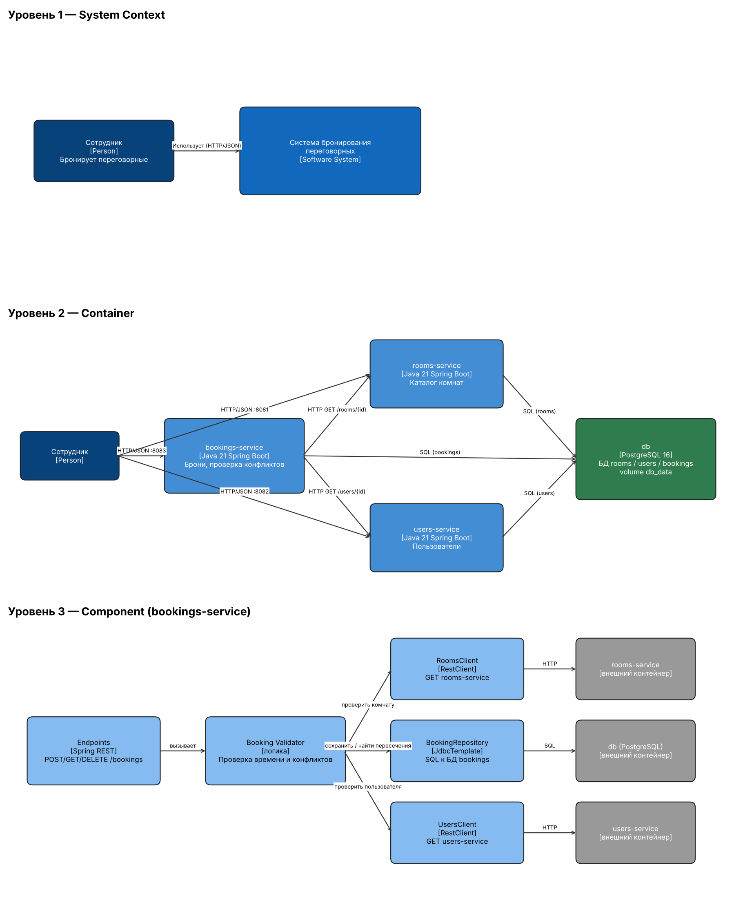

# Система бронирования переговорных комнат

Учебный проект «Контрольная точка»: микросервисная система в Docker Compose.

## Какую задачу решает
Сотрудники бронируют переговорные комнаты. Система не даёт забронировать несуществующую комнату,
несуществующего пользователя и пересекающееся по времени окно.

**Минимальный сценарий:** создать комнату → создать пользователя → создать бронь → повторная бронь на то же время
возвращает `409` → список броней → перезапуск контейнеров → данные на месте.

## Сервисы
| Сервис | Ответственность | Порт на хосте | БД |
|---|---|---|---|
| `rooms-service` | каталог комнат (CRUD-чтение/создание) | 8081 | `rooms` |
| `users-service` | пользователи | 8082 | `users` |
| `bookings-service` | брони; по HTTP обращается к `rooms-service` и `users-service`, проверяет конфликты времени | 8083 | `bookings` |
| `db` | PostgreSQL 16, volume `db_data` | — | — |

Каждый сервис владеет своей базой (в одном контейнере PostgreSQL), базы создаёт `db/init.sql`.

## Взаимодействие сервисов
`bookings-service` при `POST /bookings` делает HTTP-запросы `GET /rooms/{id}` и `GET /users/{id}` во внутренней сети Docker
(`http://rooms-service:8080`, `http://users-service:8080`). Адреса задаются переменными `ROOMS_URL` и `USERS_URL`.

## Технологии
Java 21, Spring Boot 3 (Spring Web, JdbcTemplate), Maven, PostgreSQL JDBC, Docker, Docker Compose.

## Запуск
```bash
docker compose up --build        # поднять всё (первый раз сборка занимает пару минут)
docker compose ps                # все 4 контейнера должны быть Up (db — healthy)
bash docs/api-examples.sh        # прогнать сценарий через curl
```

## API
- `rooms-service`: `GET /health`, `GET /rooms`, `GET /rooms/{id}`, `POST /rooms {"name","capacity"}`
- `users-service`: `GET /health`, `GET /users`, `GET /users/{id}`, `POST /users {"name","email"}`
- `bookings-service`: `GET /health`, `GET /bookings`, `POST /bookings {"roomId","userId","startTime","endTime"}`, `DELETE /bookings/{id}`

Коды: `201` создано, `400` неверные данные, `404` комната/пользователь не найдены, `409` время занято / email уже есть.

## Проверка сохранения данных
```bash
docker compose down              # без -v! volume db_data остаётся
docker compose up -d
curl localhost:8083/bookings     # брони на месте
```
`docker compose down -v` удаляет volume и данные.

## Архитектура (C4)
`docs/architecture.drawio` (редактируемый, 3 страницы: Context, Container, Component) и экспорт `docs/architecture.png`.



## Структура репозитория
```
rooms-service/  users-service/  bookings-service/   # код + Dockerfile
db/init.sql                                          # создание баз
docker-compose.yml
docs/  architecture.drawio  architecture.png  api-examples.sh  verification.md
```
# Booking System (Система бронирования)

## 1. Идея системы и минимальный сценарий
Система позволяет пользователям бронировать комнаты (номера). Проект реализован в виде микросервисной архитектуры.

**Сценарий:**
1. Пользователь создает учетную запись (users-service).
2. Администратор создает комнату (rooms-service).
3. Пользователь бронирует комнату на определенное время (bookings-service). При бронировании сервис проверяет, существует ли такой пользователь и комната, запрашивая данные у соседних сервисов.

## 2. Сервисы и их ответственности
- `users-service` (порт 8082) — управление пользователями (создание, получение).
- `rooms-service` (порт 8081) — управление комнатами (создание, получение).
- `bookings-service` (порт 8083) — управление бронями и логика взаимодействия с другими сервисами.
- `db` — база данных PostgreSQL (хранение всех данных).